# MSP OSD bench: what a DJI O3 / Goggles 2 really does with a flight controller's OSD

A bench for measuring how DJI goggles treat the OSD that a flight controller sends over MSP DisplayPort. It was built to
find out why some Betaflight OSD layouts freeze on DJI goggles, and its results back the Betaflight pull request
"MSP displayport: keep screens within the DJI O3/Goggles 2 load limit".

metastreamer is the eye of the bench: it shows the goggles' own picture, with the OSD composited in, as a JPEG at
`/snapshot`. The bench plays the part of the flight controller, draws a test pattern, takes a snapshot and decides
from the picture whether the goggles showed it.

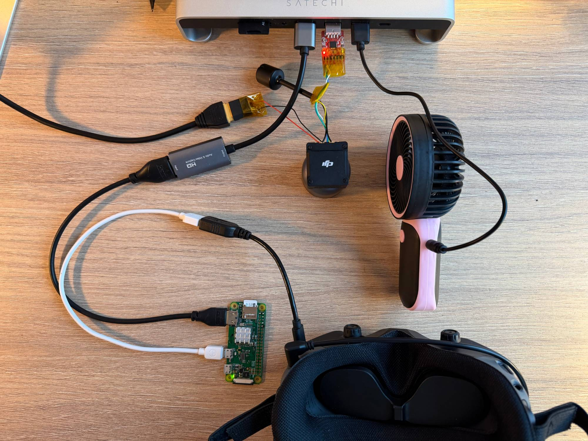

## Setup

```
 Mac (fake flight controller)     O3 Air Unit            Goggles 2                Raspberry Pi Zero W
 msplab.py / fastlab.py   ---->   UART 115200   ~~~~>    render the OSD   --USB-->  metastreamer
 MSP v1: answers the polls,       (the air unit          over the live            JPEG /snapshot
 sends MSP_DISPLAYPORT             proxies the MSP        picture                       |
        ^                          to the goggles)                                     |
        +---------------------------- HTTP /snapshot, pixel comparison ----------------+
```

- **Fake flight controller.** A 3.3 V USB-UART adapter (FTDI, CP2102 or CH340, not 5 V and not RS-232) on the air
  unit's flight controller connector: air unit TX to adapter RX, air unit RX to adapter TX, common ground, 115200 baud.
  Power the air unit separately, from a battery or a bench supply on its power pads, with a fan on it.
- **Goggles.** DJI Goggles 2 bound to the air unit. In the goggles' menu: Canvas Mode = HD (53x20), and Flight
  Controller = Betaflight (or INAV for the INAV runs). The goggles accept DisplayPort only about 8 s after a new MSP
  session starts; the scripts keep drawing a marker until then.
- **metastreamer.** A Pi Zero W on the goggles' USB-C port, see the [main README](../../README.md). Only
  `/snapshot` is needed. HDMI out to a capture stick is optional, it is only for watching the goggles' screen live.

Tested with an O3 Air Unit (firmware 2024-07) and Goggles 2 (firmware 2025-02).

## Scripts

Python 3 with `pyserial` and `Pillow`.

| File | What it does |
| --- | --- |
| `msplab.py` | The fake flight controller. Answers the air unit's MSP polls like Betaflight 4.5, disarmed, keeps a DisplayPort session alive, and runs short experiments (sub-commands, attributes, canvas, font pages, persistence, MSP v2 and more), each with snapshots and a contact sheet. Also the library of the other two. |
| `fastlab.py` | Finds how much OSD the goggles accept in one frame, by bisection. Read its docstring first. |
| `osdrate.py` | How fast the goggles really redraw, and whether the frames tear. |
| `motion_usb.py`, `cms_usb.py` | The flight controller runs without a sniffer: snapshots, attitude and the driver's debug values over USB; the CMS driven with `MSP_SET_RAW_RC`. |
| `motion_gif.py` | The before/after loops from two motion runs. |
| `budget_model.py` | The size of a screen in the goggles' encoding (see "The exact limit"), checked against every bisection below. |
| `streams/` | Raw MSP byte streams of real Betaflight OSD frames, see `streams/README.txt`. |

## Status of the scripts

The numbers below come from a first version of `fastlab.py` that was a scratch script. The published `fastlab.py` is a
cleaned-up rewrite of it: the trial and bisection logic is the same, the groups were rebuilt. In Betaflight mode one run
of `core` and a spot check of the glyph pass (`G1 --codes 0x00,0x01,0x06,0x7F,0x80,0x9C,0xFF`) with this version gave 637,
620, 361 and 459 as before, with clean control frames, and none of those glyphs costs more than an X. In INAV mode the
first run of the rewrite gave 461 instead of 526 for rows of 50: one lost frame was read as "discarded" and moved the
bisection down. A frame now counts as discarded only after two attempts in a row; INAV mode was not run again with this
version, the original script gave 537, 526, 326 and 407 twice. If a single number of a group differs from the table
below, run the group again before believing it. `msplab.py` and `osdrate.py` differ from the ones used only in their
default serial port and snapshot address. Do not run the bench while another program draws on the same OSD.

## How a measurement works

The goggles silently throw away a whole frame (`CLEAR_SCREEN` ... `DRAW_SCREEN`) that carries too much, and go on
showing the previous one. `fastlab.py` draws a label `PREVIOUS FRAME` at row 19, column 38, waits until the snapshot
shows it, sends the test frame, and polls the snapshot: label gone means shown, label still there after 1.9 s means
discarded. Test frames never touch row 19. Byte streams may cover the label, so they are judged by pixel difference
against the reference screen instead. A limit is the largest N still shown, found by bisection, and the frames at N and
N + 1 are saved as `...-N-ok.jpg` and `...-N+1-drop.jpg`. Unless said otherwise, a test frame is N single-glyph
`WRITE`s.

```
python3 fastlab.py core                     # the headline numbers below
python3 fastlab.py G1                       # every glyph code 0x00-0xFF
python3 fastlab.py V I R                    # the byte streams of real frames
python3 fastlab.py --mode inav --prefix inav- core I attr    # after switching the goggles to INAV
```

Pass `--port` for the UART and `--snapshot` for the metastreamer address if they differ from the defaults.

## Results

HD canvas, 53 columns by 20 rows. N is the number of cells written since the last `CLEAR_SCREEN`.

| Layout | Betaflight mode | INAV mode |
| --- | --- | --- |
| Solid rows of 53 cells from column 0 | 637 | 537 |
| Solid rows of 50 cells from column 2 | 620 | 526 |
| Single cells two columns apart, 26 per row | 361 | 326 |
| Pairs of cells with one blank cell between, 17 per row | 459 | 407 |

The limit is not a plain count of cells. Other things that were measured:

- Spaces count like any other cell. Rewriting a cell is free. Erasing with spaces gives nothing back, erasing with 0 does.
- The order of the writes does not matter.
- No glyph code costs more than an X (all 256 were checked). Codes 0x01-0x0F fit 850 cells in solid rows of 53, code 0
  any number: a 0 inside a `WRITE_STRING` is a blank cell, not the end of the string.
- Solid rows of 40 to 52 cells: 617 to 629 cells. Runs of 2, 3, 5, 10 and 25 cells with one blank between: 471, 512, 563,
  586 and 613. Pairs with a three-cell gap: 396.
- `WRITE_STRING` draws 32 characters, a string past column 52 continues on the next row.
- About 30 to 40 `DRAW_SCREEN`/s are rendered, more only queue up, and latency grows to 5 s at 100 Hz.
- Ignored: `MSP_DP_SYS`, blink, `MSP_DP_OPTIONS`, `MSP_DP_FONTCHAR_WRITE`, sub-commands 7 to 255, MSP v2,
  `MSP_SET_OSD_CANVAS` and `MSP_OSD_CANVAS` pushed by the flight controller.
- In INAV mode font page 0 is the INAV font, page 1 holds other INAV symbols and pages 2 and 3 are empty, so with
  Betaflight's default `displayport_msp_fonts = 0,1,2,3` info text is garbage and warnings are not visible.

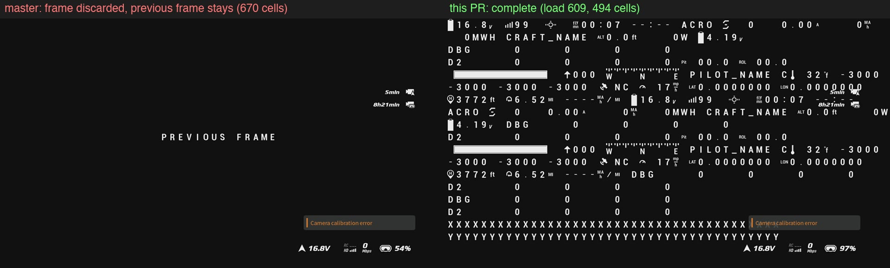
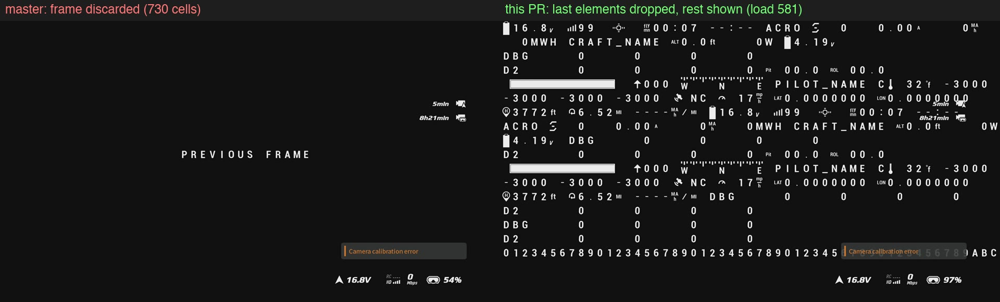
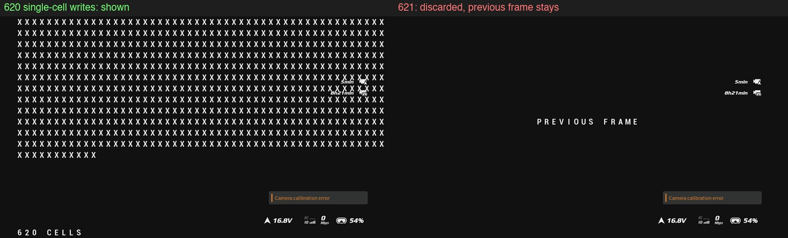
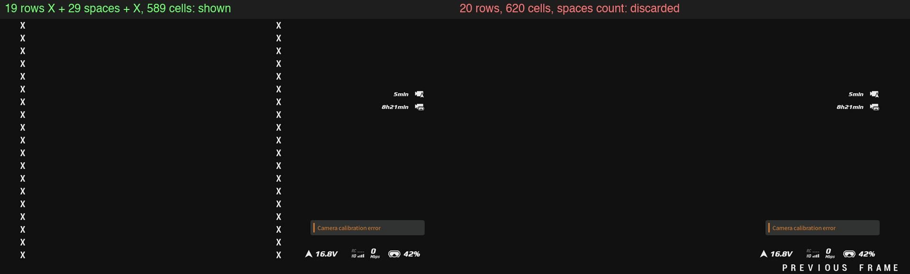
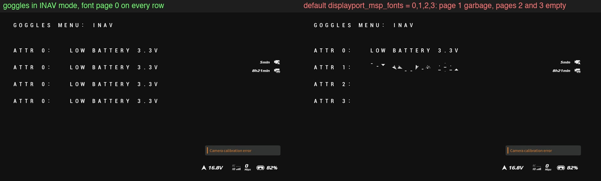

## The exact limit (2026-10-14, Betaflight mode)

The goggles judge the screen they hold at the draw, in an encoding: the 53x20 cells, a byte each and 0 for a blank one,
read row by row as 265 little-endian 32 bit words, each coded in LEB128 (1 byte below 2^7, 2 below 2^14, 3 below 2^21,
4 below 2^28, 5 above). A screen of up to 902 bytes is shown, one of 903 or more is discarded.

- `budget_model.py` gives 901-902 bytes at every limit measured above (38 bisections: solid rows, runs, isolated cells,
  pairs, glyph codes, mixes of glyphs) and 903-905 one cell further.
- Eight random screens of random glyphs, made to come to 898-908 bytes, were shown or discarded exactly as the model said;
  a screen of 392 cells was discarded and one of 438 shown.
- So a space costs like any other glyph, a cell erased with 0 costs nothing (500 X drawn, 200 erased with 0, 250 more:
  shown; erased with spaces: discarded), and the look of a glyph does not matter (invisible 0xA0 costs like X).
- What a word costs depends on its last cell that is not blank: codes 0x01-0x0F in the fourth cell of a word are cheaper,
  so 0x01 alternating with X fits 850 cells in one phase and 637 in the other, and pairs XX fit 318 to more than 502 cells
  depending on where they fall in the words. A checkerboard of X fits 425, the same cells as columns 361.
- `MSP_DP_RELEASE` blanks the OSD, and what is written after it is not drawn until a clear.
- With the goggles in INAV mode the encoding is a different one, not modelled: a cell costs 17 to 20 units of about
  10200 depending on its code, and where it falls in a word hardly matters.

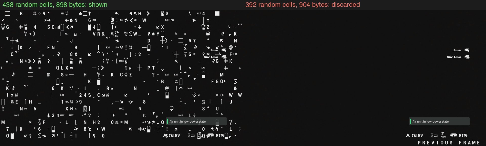
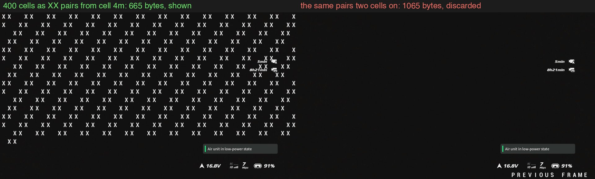
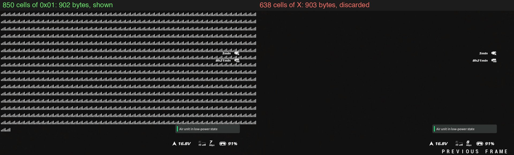
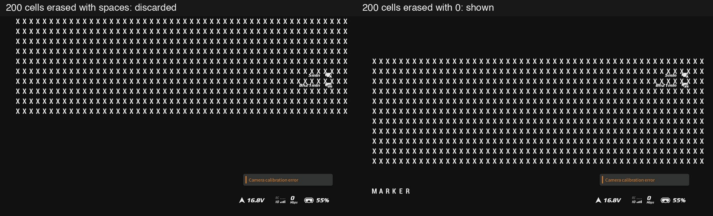

New `fastlab.py` groups: `cheap` (every code above the X limit), `mix`, `checker`, `align`, `erase`, `release`, `nul`,
`inavmodel`. Raw results of that day are in the release `msp-osd-bench-2026-10-14`.

## DJI's own interface on top of the OSD

The goggles draw their own widgets over the flight controller's characters. In the blank screen of the bench, with the
HD canvas of 53x20 cells (the same in Betaflight and INAV mode), they sit in three places, the cells counted from 0:

| Zone | Cells | What |
| --- | --- | --- |
| A | rows 5-6, columns 44-49 | remaining recording time of the air unit and of the goggles |
| B | row 16, columns 36-49 | notifications, with their own background |
| C | row 18, columns 35-48 | air unit voltage, link, bitrate, goggles battery |

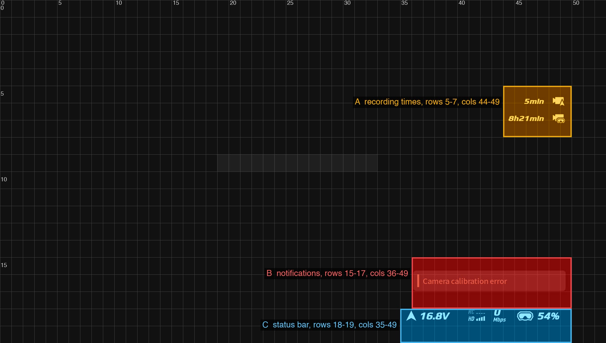

Measured on Goggles 2 (firmware 2025-02) with the default goggles interface, in 12 frames of the Betaflight mode and
9 of the INAV mode that show only the test marker. Other goggles settings, other firmware and the Normal canvas mode
were not measured.
Each widget is given the rows its text lines sit in: two for the recording times, one for the notifications and one for
the status bar. Their edges reach a few pixels into the next row.

The raw captures of this series, about 80 snapshots with their logs, are in the release
[msp-osd-bench-2026-10-12](https://github.com/350d/metastreamer/releases/tag/msp-osd-bench-2026-10-12).

metastreamer is an independent project. It is not affiliated with, endorsed by or connected to DJI.

## On a flight controller

For the results in betaflight/betaflight#15828 the fake flight controller was replaced by a Mamba F722
(MAMBAF722_I2C) running master or the pull request, on UART2 at 115200, with a USB-UART adapter listening on its TX
line. The layout is a heavy one with 50 elements, among them the artificial horizon and sidebars, the compass bar, both
stick overlays, PIDs, GPS, timers, battery and power values and warnings:

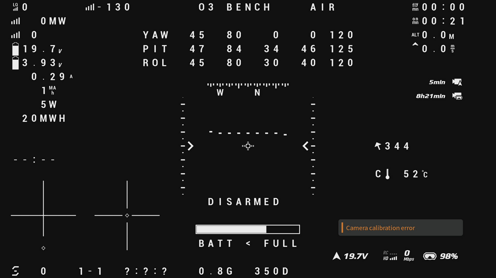

The flight controller was turned by hand for 30 s per run so that the horizon and values change every frame, and the
goggles were snapshotted twice a second. These loops play 10 s of those snapshots at twice the speed, master on the
left and the pull request on the right. For master they are the 10 s of the run with the most elements missing, by
the lit pixels of the snapshots; the two sides are separate runs, not the same moment. Master was run on 2026-10-13
with the sniffer; the right side is the pull request at 0b263577d (the exact DJI limit, 0 for blank cells) on
2026-10-14, the 10 s with the most roll, run without a sniffer (`motion_usb.py`); the layout picture is from that run.
All 52 and 60 snapshots of those runs show the whole screen. `motion_gif.py` builds the loops:

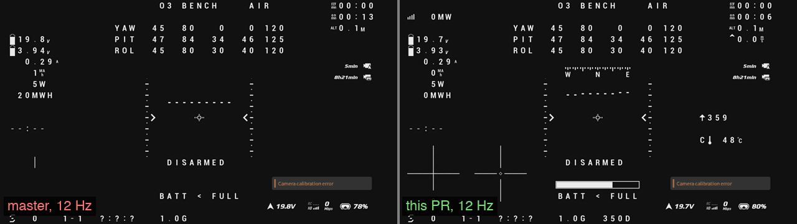
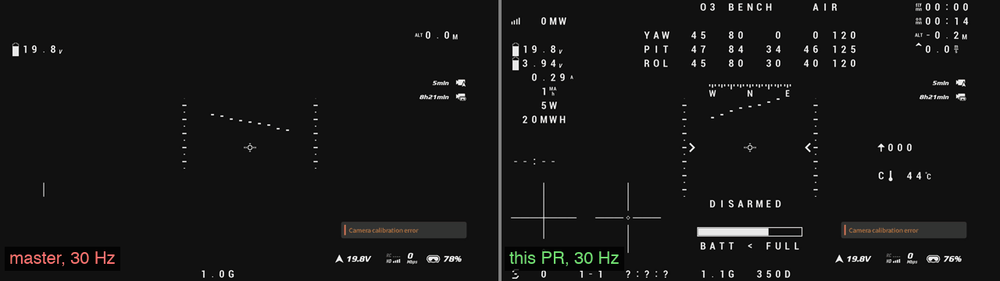

